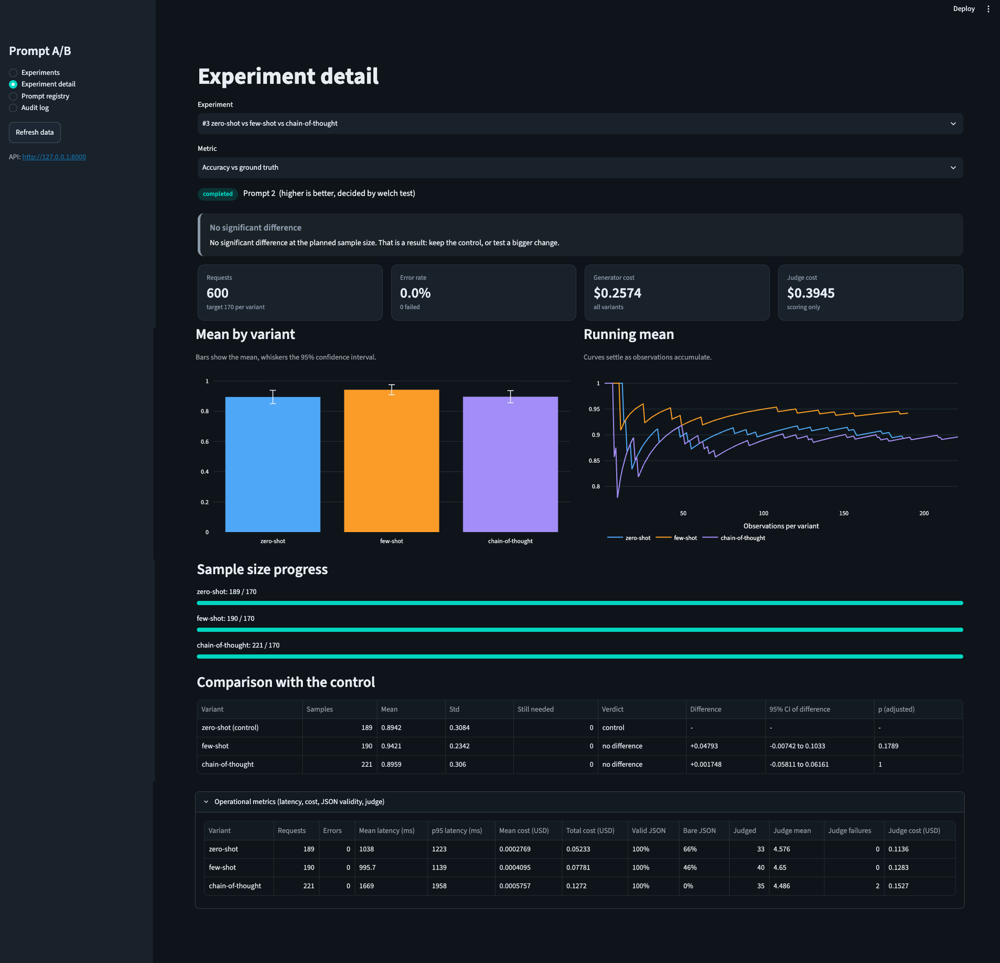
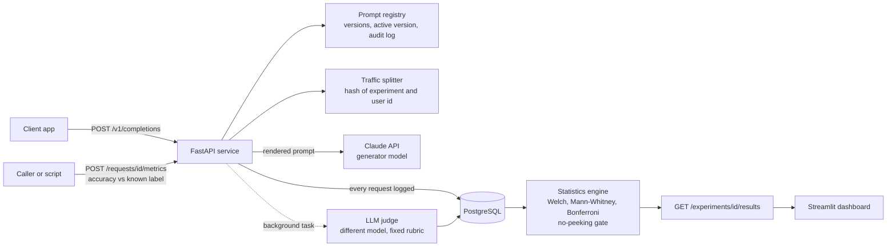

# Prompt A/B

A platform for versioning LLM prompts and A/B testing them on live traffic, with statistics that refuse to declare a winner too early. It covers the whole path: a prompt registry with rollback and an audit log, deterministic traffic splitting, an async LLM judge, a significance engine, and a dashboard. I demonstrated it on a support-email classifier.

**Demo result:** three prompt variants, 600 requests, accuracy measured against known labels. **No variant was significantly better** (89.4%, 94.2% and 89.6%). The more useful finding was where the errors come from: a single email category (*general*, 71% accuracy against about 98% for the other three).



## The experiment

Task: classify a support email as billing, technical, account or general. Three prompts, all on Claude Haiku 4.5, differing only in technique. Users were assigned to variants by hash, and each answer was scored against the email's known category.

| Variant | Requests | Accuracy | Difference vs zero-shot (95% CI) | Adjusted p | Cost per 1,000 requests | Mean / p95 latency |
|---|---|---|---|---|---|---|
| zero-shot (control) | 189 | 89.4% | - | - | $0.277 | 1038 / 1223 ms |
| few-shot | 190 | 94.2% | +4.8 pts (-0.7 to +10.3) | 0.179 | $0.410 | 996 / 1139 ms |
| chain-of-thought | 221 | 89.6% | +0.2 pts (-5.8 to +6.2) | 1.000 | $0.576 | 1669 / 1958 ms |

**Verdict: no significant difference** at the planned 170 observations per variant (Welch test, Bonferroni-corrected for two comparisons). Accuracy was about 91%, so the smallest gap this run could reliably detect was about 8 points, and a 4.8-point gap cannot be resolved. Chain-of-thought cost twice as much and was 1.6 times slower for no accuracy gain. Decision: keep zero-shot (cheapest, fastest, statistically tied). Few-shot deserves a larger follow-up, because if its gain is real it costs about $0.003 per extra correct answer.

Format compliance differed a lot: replies with no markdown code fence were 66%, 46% and 0% of outputs, although 100% of replies contained valid JSON once extracted.

### Where the errors come from

| True category | Accuracy | Requests |
|---|---|---|
| account | 97.9% | 141 |
| billing | 98.0% | 151 |
| technical | 97.4% | 155 |
| **general** | **71.2%** | 153 |

44 of the 54 errors (81%) were *general* emails, and 34 of those were called *technical*. Two separate causes:

- **How-to and feature questions called "technical"** (17 of the 21 errors on easy and short emails). The prompts never define the categories. Few-shot examples fixed most of this: 95.0% on easy and short general emails against 70.6% for zero-shot (exploratory, post-hoc, p = 0.009).
- **Emails where a real problem follows a question or praise** ("love the dashboard, also my card was charged twice"). Accuracy was 41-50% for every variant. The prompts say "first problem the customer states", and a question is not a problem. This is partly a routing-policy question, not only a model error: sending such an email to the real problem is arguably better for a support queue.

Two checks on that finding:

- **Difficulty mix.** Random assignment gave few-shot only 18% hard general emails against 32% and 31% for the others, which flatters it. Standardised to the same mix, the gap shrinks but remains: about 81% against 65% and 66% on general emails, instead of the raw 86% against 64% and 65%.
- **Near-duplicates.** 27% of the generated emails were in near-duplicate pairs (a lower bound). Keeping one email per cluster (488 requests) lowered overall accuracy from 91.0% to 89.3%, left the general-class weakness and the easy/short few-shot advantage in place (93.5% against 66.7%), and gave few-shot 93.4% against 87.2% overall (p = 0.064, below the planned sample size, so not a decision).

## What it does

- **Prompt registry:** versioned prompts with templates (`{{variable}}`), activation as rollback, and an audit log of every change.
- **Experiments:** two or more variants with traffic shares. A user is assigned by hashing `experiment_id:user_id`, so the same user always sees the same variant, and each assignment is recorded.
- **Metrics:** latency, tokens, cost, errors and JSON validity on every request. Callers can record their own per-request metrics such as accuracy against a known label (`POST /requests/{id}/metrics`).
- **LLM judge:** an optional 1-5 quality score computed after the response is sent, by a different model than the generator, against one fixed rubric per prompt. Sampling is configurable (`JUDGE_SAMPLE_RATE`).
- **Statistics:** Welch's t-test and Mann-Whitney U, a confidence interval for the difference, Bonferroni correction for several challengers, the smallest detectable effect, and a sample-size calculator.
- **No-peeking rule:** until every variant reaches its planned sample size, the API shows interim numbers but every verdict is `pending`. No winner can be declared early.
- **Dashboard:** experiment list, detail page (verdict banner, confidence-interval bars, running means, comparison table), prompt registry with version diffs, and the audit log.



## Design decisions

- **A winner needs the planned sample size.** Looking at an experiment repeatedly and stopping at the first p < 0.05 inflates false positives. `scripts/peeking_simulation.py` runs 2,000 simulated A/A experiments (no real difference): one look at the planned size gives about 5% false winners, checking 20 times gives about 23%. So the API enforces the rule instead of trusting the reader.
- **Ground-truth accuracy is the primary metric, not the judge.** In the demo the judge cost about $0.0036 per scored request, roughly 8 times the classifier's average cost per request, and its mean scores were all between 4.5 and 4.7. A deterministic metric against a known label was free and more informative.
- **One fixed rubric per prompt.** Without it, the judge grades each variant against its own instructions, so a prompt that asks for the wrong thing could still score well.
- **The judge is a different model from the generator**, to avoid a model grading its own style. (Both are Anthropic models, which is a limitation.)
- **The first variant is the control.** Challengers are compared with it, and p-values are Bonferroni-adjusted for the number of challengers.
- **Rank test for ordinal and skewed metrics.** Mann-Whitney decides for judge scores and latency, Welch's t-test for the rest. Both p-values are always reported.
- **Failures are visible.** Failed requests keep a log row, and a failed judge call is stored as a `judge_error` row, so missing scores are never silently dropped.
- **The API never lets a request choose its model.** The model comes from the prompt version.

## What did not work, and limitations

- **No variant won.** The demo could detect gaps of about 8 points and the observed gap was 4.8. Confirming a gap that size would take roughly 500 to 600 requests per variant.
- **The LLM judge is not validated against human scores.** Round 1 of my own scoring gave a weighted kappa of 0.24 (95% interval -0.20 to 0.57, 23 items). Looking at the disagreements, my scores did not follow the rubric on outputs that were wrong by construction (I gave 5 to summaries that described a different problem), while the judge's mean scores matched the rubric's scale (1.00 for unusable replies, 2.00 for wrong categories, 3.00 for invented summaries). I did not run a second round, so the judge is only a secondary metric here. As a negative control, feeding the tooling random scores gave kappa -0.25, inside the range chance produces (-0.40 to 0.40). The tools are in `scripts/calibration_*.py`, the data in `calibration/`.
- **Labels are machine-written.** The emails come from Claude with the label known by construction, then were only spot-checked by hand. Claude also classifies them, which can make the task look easier than real email. Label noise caps achievable accuracy.
- **The generated emails repeat themselves** (27% in near-duplicate pairs, a lower bound), so the effective sample is smaller than 600. Exact-text de-duplication missed pairs that differ only in punctuation and case.
- **Subgroup results are post-hoc.** The per-class and per-difficulty findings come from slicing the data after seeing it. They are hypotheses, not confirmed results.
- **Random assignment does not balance difficulty.** A stratified or paired design would remove the mix effect described above.
- **Temperature is stored with each prompt version but not sent to the API**, because the SDK version used rejected the parameter. Outputs use the provider default.
- **Smaller gaps:** no authentication, no database migrations (tables are created on first use), judge jobs run as in-process background tasks rather than a durable queue, and prices are hard-coded in `app/llm.py` (check them against the provider).

## Run it yourself

Requirements: Python 3.12, [uv](https://docs.astral.sh/uv/), Docker, and an Anthropic API key.

```bash
git clone https://github.com/Asm2910/prompt-ab.git && cd prompt-ab
uv sync
cp .env.example .env          # then put your ANTHROPIC_API_KEY in .env
docker compose up -d          # PostgreSQL
uv run --env-file .env uvicorn app.main:app --reload     # API on :8000, docs at /docs
uv run streamlit run dashboard/app.py                    # dashboard on :8501
```

Tests use a fake LLM and in-memory SQLite, so they need no API key and no Docker:

```bash
uv run pytest -q
```

Reproduce the demo (the email set used for the results is committed in `data/support_emails.json`, so you can skip the first step; the whole run costs well under $1 in API usage):

```bash
uv run python scripts/generate_emails.py               # optional: a new labelled email set
uv run python scripts/seed_demo.py --start             # prompt, 3 variants, rubric, experiment
uv run python scripts/simulate_traffic.py --prompt-id <id> --users 600 --workers 4
uv run --env-file .env python scripts/error_analysis.py --experiment-id <id> --dedupe
```

I ran the demo with `JUDGE_SAMPLE_RATE=0.2`. In it, the classifier cost about $0.26 and the judge about $0.39.

## API

| Endpoint | Purpose |
|---|---|
| `POST /prompts`, `GET /prompts` | Create and list prompts |
| `POST /prompts/{id}/versions`, `GET /prompts/{id}/versions` | Add and list versions |
| `POST /prompts/{id}/activate` | Make a version active (rollback is the same call) |
| `PUT /prompts/{id}/rubric`, `GET /prompts/{id}/rubric` | The fixed judge rubric |
| `POST /experiments`, `GET /experiments` | Create and list experiments |
| `POST /experiments/{id}/start`, `POST /experiments/{id}/stop` | Run and freeze an experiment |
| `POST /v1/completions` | Serve a request (routes through the running experiment) |
| `POST /requests/{id}/metrics` | Record a metric such as accuracy |
| `GET /experiments/{id}/metrics` | Per-variant latency, cost, JSON validity, judge numbers |
| `GET /experiments/{id}/results` | The statistical verdict (no-peeking rule applied) |
| `GET /experiments/{id}/series` | Running means for the charts |
| `GET /stats/sample-size` | Observations needed per variant |
| `GET /audit-log` | Every change |

## Layout

```
app/            FastAPI service: main, models, registry, experiments, splitter, llm,
                metrics, results, stats, calibration
dashboard/      Streamlit dashboard
scripts/        seed_demo, simulate_traffic, generate_emails, error_analysis,
                peeking_simulation, calibration_build, calibration_report
tests/          pytest suite (fake LLM, in-memory SQLite)
data/           the labelled demo emails
calibration/    judge calibration rounds and the negative control
docs/           dashboard screenshot
docker-compose.yml   PostgreSQL 16
```

## License

MIT.